# StockPilot

**Smarter Inventory. Better Business Decisions.**

A full-stack inventory, point-of-sale and business-management platform for small and medium businesses:
real authentication and role-based access, transactional stock control, purchasing, sales with void/refund workflows,
reporting with a clean revenue / cost / profit separation, and an audit trail.

> **Project status - please read.** This repository was produced in a sandbox that could not download Maven
> dependencies, so the verification level differs by part. See [Verification status](#verification-status) for exactly what
> was and was not executed.

## Contents
1. [Main features](#main-features) - 2. [Technology stack](#technology-stack) - 3. [Architecture](#architecture-overview) -
4. [Database & ER diagram](#database) - 5. [API documentation](#api-documentation) - 6. [Run it locally](#installation) -
7. [Demo logins](#demo-logins) - 8. [Environment variables](#environment-variables) - 9. [Testing](#testing) -
10. [Deployment on Render](#deployment-on-render) - 11. [Screenshots](#screenshots) - 12. [Verification status](#verification-status) -
13. [Future improvements](#future-improvements)

## Production readiness

See [`docs/PRODUCTION-READINESS.md`](docs/PRODUCTION-READINESS.md) for the launch gates and safe rollout plan. The hosted free-tier deployment is a demo/staging environment, not suitable for permanent business records.

## Main features

| Area | What it does |
|---|---|
| **Dashboard** | Total products, inventory value, sales today, month-to-date revenue, low-stock list, recent transactions, revenue/profit trend chart, top sellers, stock-status donut. Date filters (presets + custom range). All values come from the API/database. |
| **Products** | Create/edit/archive/restore, SKU + barcode, category, supplier, cost & selling price, minimum stock, image URL. Search, sorting, category filter, pagination, stock-status badges. |
| **Inventory** | Stock-in, stock-out and signed adjustments with mandatory reasons; full movement history with running balance; low-stock alerts; stock valuation at cost and retail. **Stock can never go negative.** |
| **Point of Sale** | Product search, cart, quantity controls, discount (cashier limit 5%), Cash / Bank transfer / Other, change calculator, printable receipt. A sale is one database transaction: stock, sale and payment succeed or fail together. |
| **Sales** | Searchable/filterable list (receipt no., status, dates), detail view, **void** (same day) and **refund** with reason; stock is restored and the action audited. |
| **Suppliers & purchase orders** | Supplier directory with associated products and purchase history. PO lifecycle Pending -> Approved -> Received (updates stock and cost) or Cancelled. |
| **Reports** | Daily/weekly/monthly/annual sales, best sellers, low stock, inventory valuation, purchases, revenue overview. CSV export + print. Revenue, COGS and gross profit are shown separately. |
| **Employees** | Create accounts, assign roles, activate/deactivate, admin-initiated password reset (one-time temporary password, forced change at next login). |
| **Audit log** | Login attempts (including failures), product/stock/sale/refund/purchase/user changes, with user, time, IP. Filterable. |
| **UX** | Collapsible sidebar, light/dark theme, toasts, loading/empty/error states, confirmation dialogs, responsive layout, keyboard-accessible dialogs. |

Roles: **ADMIN** (everything), **MANAGER** (products, inventory, suppliers, purchases, sales, reports), **CASHIER** (POS, own sales, read-only products without cost prices).
Permissions are enforced by the backend (`@PreAuthorize` + service-level checks); the frontend guards are only a usability layer.

## Technology stack

- **Frontend:** React 18, TypeScript, Vite, Tailwind CSS, React Router, React Hook Form + Zod, Recharts, Lucide icons, Vitest + Testing Library
- **Backend:** Java 21, Spring Boot 3.3, Spring Security (JWT, BCrypt), Spring Data JPA/Hibernate, Bean Validation, springdoc-openapi, JUnit 5, Mockito, Testcontainers
- **Database:** PostgreSQL 16, Flyway migrations
- **Tooling/deploy:** Maven, Docker & Docker Compose, Render (Blueprint in `render.yaml`)

## Architecture overview

```
 Browser (React SPA)  --JWT in Authorization header-->  Spring Boot REST API  -->  PostgreSQL
   routes, forms,            /api/**  (controllers)        services (business rules,
   charts, receipts          + Swagger UI                    transactions, audit)
                                                          repositories (Spring Data JPA)
                                                          Flyway-managed schema
```

```
stockpilot/
  backend/    Spring Boot app  (controller -> service -> repository, DTO records, global error handler)
  frontend/   React + Vite SPA (pages, ui components, contexts, api client)
  database/   demo-data generator (migrations live in backend/src/main/resources/db)
  docs/       ER diagram, engineering decisions, Postman collection, screenshots + capture script
  scripts/    smoke_test.py (live API checks)
  .github/    CI workflow
  docker-compose.yml  render.yaml  .env.example
```

Key design points (details in [`docs/DECISIONS.md`](docs/DECISIONS.md)):
- **One choke point for stock.** `InventoryService.applyChange` locks the inventory row, refuses negative results and appends an immutable `stock_movements` row. Sales, voids, refunds, purchase receipts and manual adjustments all use it.
- **Atomic POS checkout.** Lines are processed in product-id order inside one transaction; any failure rolls back the sale, payment and every stock movement.
- **Server-side truth.** Prices, costs, totals and permissions are recomputed/checked on the server; the browser's cart maths is only a preview.
- **Defence in depth.** DB constraints (`CHECK`, `UNIQUE`, FKs) back up service validation.

## Database

Migrations: [`backend/src/main/resources/db/migration/V1__core_schema.sql`](backend/src/main/resources/db/migration/V1__core_schema.sql).
ER diagram (Mermaid, renders on GitHub): **[`docs/ER-DIAGRAM.md`](docs/ER-DIAGRAM.md)**.
Tables: `users, categories, suppliers, customers, products, inventory, stock_movements, purchases, purchase_items, sales, sale_items, payments, audit_logs`.

## API documentation

With the backend running: **Swagger UI** at `http://localhost:8080/swagger-ui.html`, raw OpenAPI at `/v3/api-docs`.
Log in via `POST /api/auth/login`, copy the token, press **Authorize**.

| Group | Endpoints (summary) | Roles |
|---|---|---|
| Auth | `POST /api/auth/login`, `/logout`, `/change-password`, `GET /api/auth/me` | public / any |
| Products | `GET /api/products` (search, sort, page, `categoryId`), `GET/PUT/DELETE /api/products/{id}`, `POST /api/products`, `POST /{id}/restore` | read: all; write: Admin, Manager |
| Categories | `GET/POST /api/categories`, `PUT/DELETE /{id}` | read: all; write: Admin, Manager |
| Inventory | `GET/POST /api/inventory/movements`, `GET /api/inventory/low-stock` | Admin, Manager |
| Sales | `POST /api/sales` (checkout), `GET /api/sales`, `GET /{id}`, `POST /{id}/void`, `POST /{id}/refund` | checkout/read: all (cashier = own); void/refund: Admin, Manager |
| Suppliers | `GET/POST /api/suppliers`, `GET/PUT /{id}`, `GET /{id}/products`, `GET /{id}/purchases` | Admin, Manager |
| Purchases | `GET/POST /api/purchases`, `GET /{id}`, `POST /{id}/approve`, `/receive`, `/cancel` | Admin, Manager |
| Dashboard / Reports | `GET /api/dashboard`, `/api/reports/{sales,best-selling,low-stock,inventory-valuation,purchases,revenue-overview}` | Admin, Manager |
| Users | `GET/POST /api/users`, `PUT /{id}`, `POST /{id}/reset-password` | Admin |
| Audit | `GET /api/audit-logs` | Admin |
| Health | `GET /actuator/health` | public |

Errors share one JSON shape: `{ timestamp, status, error, message, path, fieldErrors? }`.

## Installation

### Option A - Docker (recommended)
```bash
cp .env.example .env            # edit secrets
docker compose up --build
```
Frontend http://localhost:5173 - API http://localhost:8080 - Swagger http://localhost:8080/swagger-ui.html

### Option B - run the pieces yourself
Requirements: JDK 21, Maven 3.9+, Node 22+, PostgreSQL 16.
```bash
# database
createdb stockpilot            # or: docker run -e POSTGRES_PASSWORD=stockpilot -e POSTGRES_USER=stockpilot -e POSTGRES_DB=stockpilot -p 5432:5432 postgres:16-alpine

# backend
cd backend
export JWT_SECRET="$(openssl rand -base64 48)"
export FLYWAY_LOCATIONS="classpath:db/migration,classpath:db/seed"   # demo data; omit for an empty DB
mvn spring-boot:run

# frontend
cd frontend
npm install
VITE_API_URL=http://localhost:8080 npm run dev
```

## Demo logins

Available when the backend runs with the demo seed (`FLYWAY_LOCATIONS` includes `classpath:db/seed`, the default in `docker-compose.yml`).
**Demo only - never use these in production.**

| Role | Username | Password |
|---|---|---|
| Admin | `admin` | `Admin@12345` |
| Manager | `manager` | `Manager@12345` |
| Cashier | `cashier` | `Cashier@12345` |

The seed contains 4 users, 5 categories, 4 suppliers, 22 products, 8 purchase orders (received / pending / approved / cancelled),
~200 sales across 30 days (including one void and one refund), ~520 stock movements and sample audit entries, all mutually consistent
(stock = sum of movements; sale totals = sum of lines; payments = totals). A few products are intentionally low on stock.
Regenerate with `pip install bcrypt && python database/generate_demo_seed.py`.

**Suggested tour:** sign in as `cashier` -> make a sale at the POS and print the receipt -> sign in as `manager` -> see stock drop, void the sale, receive a purchase order, open Reports -> sign in as `admin` -> create an employee and read the audit log.

## Environment variables

| Variable | Used by | Default | Notes |
|---|---|---|---|
| `JWT_SECRET` | backend | *(none, required)* | >= 32 chars. The app refuses to start without it. `openssl rand -base64 48` |
| `JWT_EXPIRATION_MINUTES` | backend | `480` | |
| `DB_HOST` `DB_PORT` `DB_NAME` `DB_USERNAME` `DB_PASSWORD` | backend | localhost / 5432 / stockpilot / stockpilot / stockpilot | |
| `DB_SSLMODE` | backend | `prefer` | `require` for external managed databases |
| `CORS_ALLOWED_ORIGINS` | backend | `http://localhost:5173` | comma-separated list of frontend origins |
| `FLYWAY_LOCATIONS` | backend | `classpath:db/migration` | add `,classpath:db/seed` for demo data |
| `APP_TIMEZONE` | backend | `UTC` | business time zone for "today" and report buckets |
| `JPA_DDL_AUTO` | backend | `none` | set `validate` to assert entity/schema alignment |
| `PORT` | backend | `8080` | Render sets this |
| `VITE_API_URL` | frontend (build time) | `http://localhost:8080` | public URL of the API |

No secrets are committed; `.env` is git-ignored.

## Testing

```bash
# backend: unit tests (Mockito) + API integration tests
cd backend && mvn clean verify
```
- Unit: `SaleCalculatorTest` (rounding, discounts, margin), `InventoryServiceTest` (never negative, movement balances), `SaleServiceTest` (merged lines, lock order, discount permissions, void/refund rules), `UserServiceTest` (BCrypt, last-admin protection).
- Integration: `StockPilotApiTest` runs the real app against PostgreSQL via **Testcontainers** (needs Docker; skipped automatically without it). It covers login/lockouts, RBAC per role, checkout reducing stock, insufficient-stock rollback (including multi-line), discount permission, void restoring stock, purchase receive-once, validation errors, report arithmetic, and schema/entity alignment (`ddl-auto=validate`).

```bash
# frontend
cd frontend && npm test        # Vitest + Testing Library
npm run build                  # type-check + production build

# against a running stack (docker compose up): ~45 live API checks, standard library only
python3 scripts/smoke_test.py
```
Also included: a **Postman collection** (`docs/postman/StockPilot.postman_collection.json`, 49 requests; run a *Login* request first, it stores the JWT) and a **GitHub Actions** pipeline (`.github/workflows/ci.yml`: backend `mvn verify`, frontend build + tests, and a docker-compose API smoke test).

## Deployment on Render

1. Push this repo to GitHub.
2. Render dashboard -> **New -> Blueprint** -> pick the repo. `render.yaml` creates a PostgreSQL database, the API (Docker) and the static frontend.
3. After the first deploy, set two values and redeploy both services:
   - API service: `CORS_ALLOWED_ORIGINS` = the frontend URL (e.g. `https://stockpilot-web.onrender.com`)
   - Frontend service: `VITE_API_URL` = the API URL (e.g. `https://stockpilot-api.onrender.com`)
4. `JWT_SECRET` is generated by Render; the DB credentials are injected from the database resource. Flyway runs the migrations on startup.
5. Health check: `/actuator/health`. Build commands: backend `mvn clean package` (inside the Dockerfile), frontend `npm ci && npm run build`.
6. **Production vs demo:** `render.yaml` loads the demo seed so the site is explorable. For a real deployment remove `,classpath:db/seed` from `FLYWAY_LOCATIONS` and create your first admin directly in the database (BCrypt hash) or run once with the seed and then deactivate/replace the demo accounts.
7. Notes: Render's free web services sleep when idle (first request is slow) and free databases expire after a trial period - use a paid plan for anything real.

## Screenshots

Captured in headless Chromium by [`docs/screenshots/capture_screenshots.py`](docs/screenshots/capture_screenshots.py) from the real frontend build,
showing **real rows from the seeded PostgreSQL database**. The Java backend could not run in the authoring sandbox, so the browser was served by a small
stand-in API that reads the same database (the script explains this at the top). Re-capture them yourself against the real stack by pointing it at your own instance.

| | |
|---|---|
| 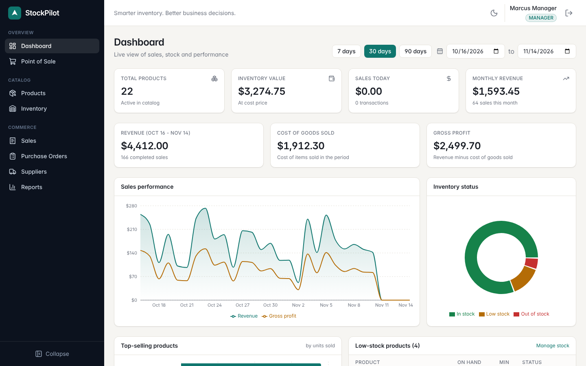 **Dashboard** | 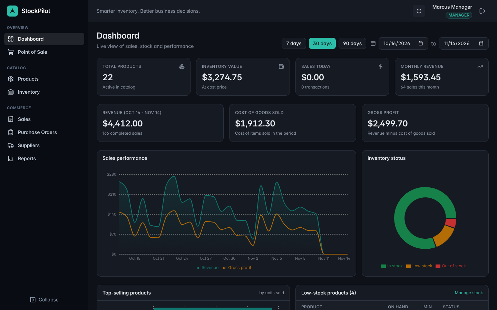 **Dark theme** |
| 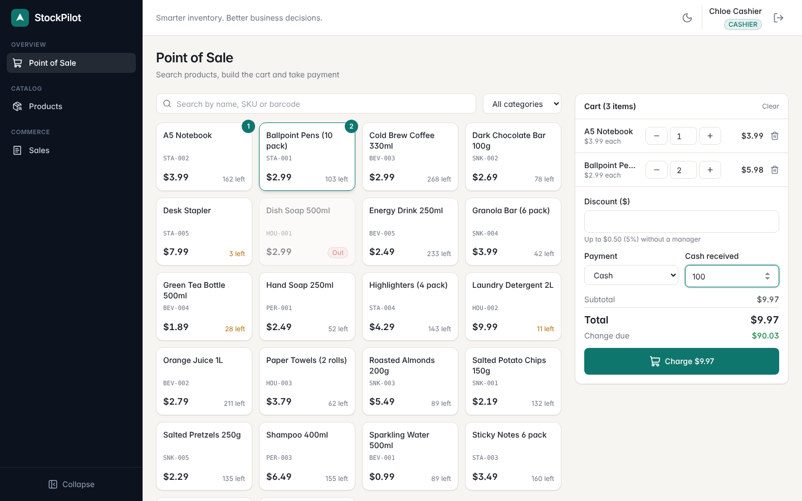 **Point of sale** (cashier, 5% discount limit enforced) | 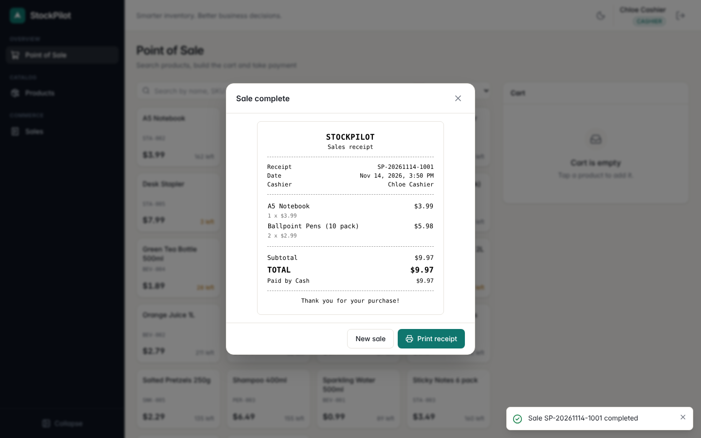 **Printable receipt** |
| 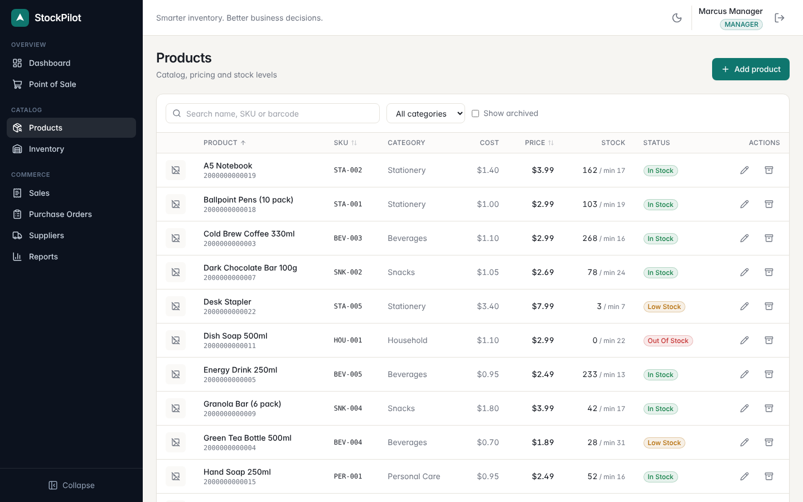 **Products** (search, sort, pagination) | 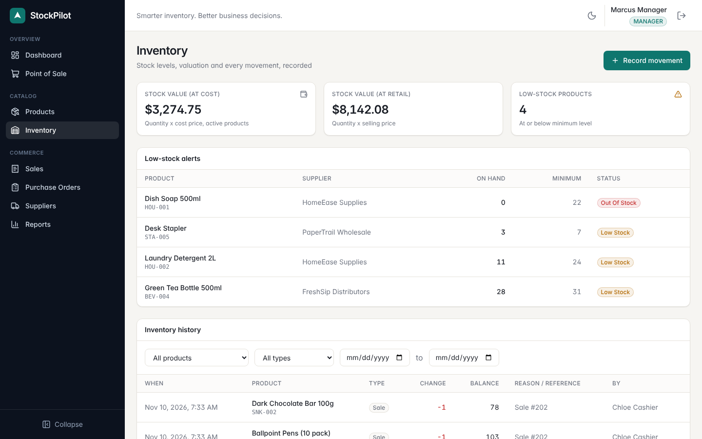 **Inventory** (valuation, low-stock, movement history) |
| 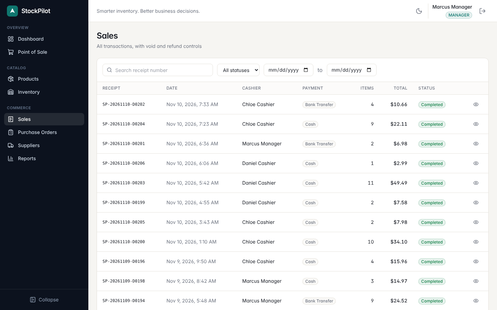 **Sales** | 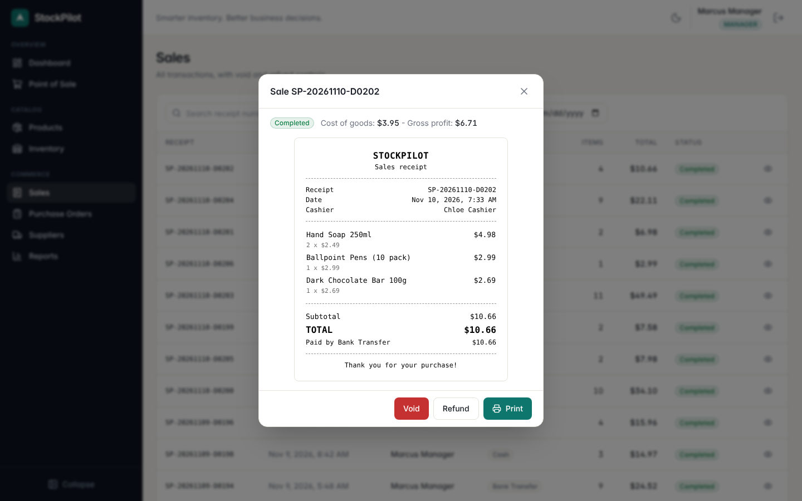 **Sale detail** (void / refund for managers) |
| 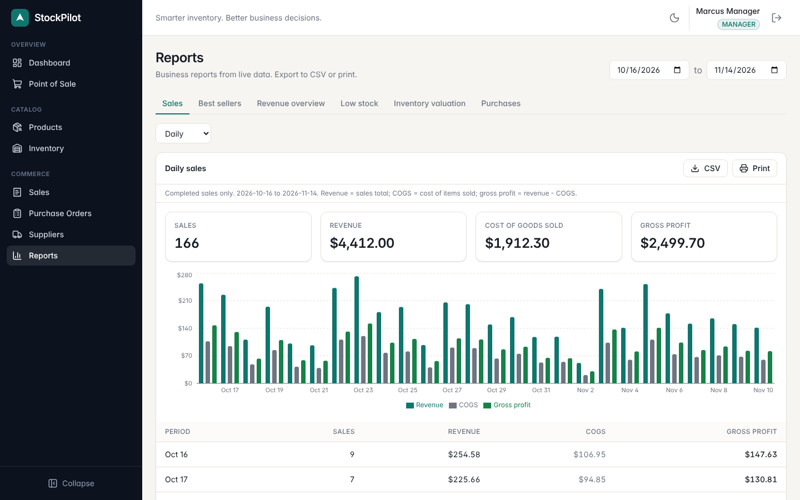 **Reports** | 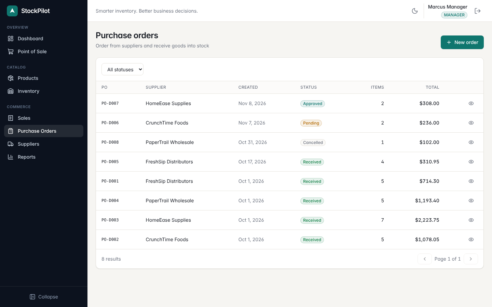 **Purchase orders** |
| 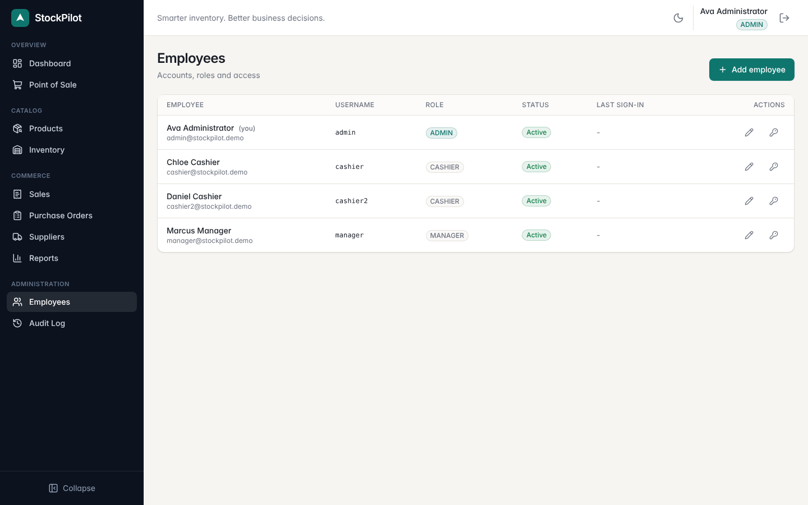 **Employees** | 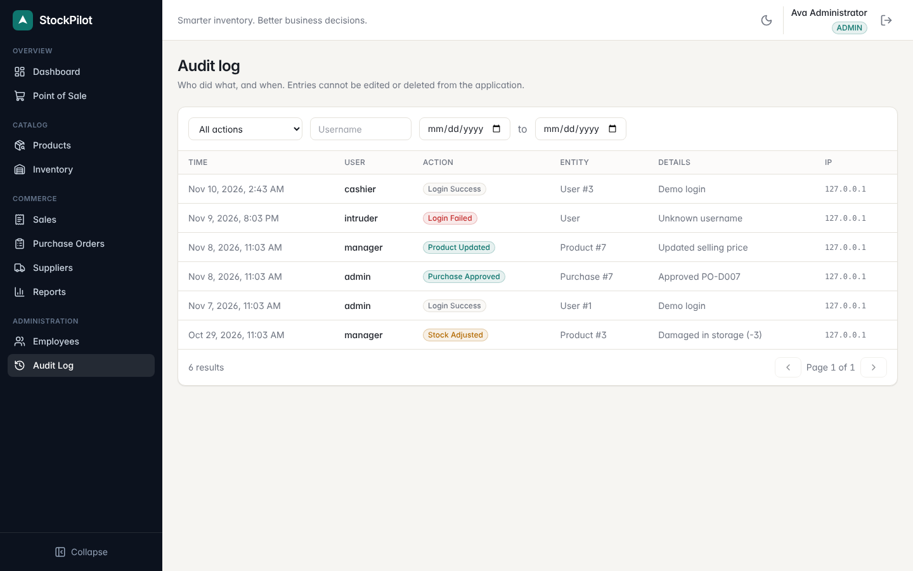 **Audit log** |
| 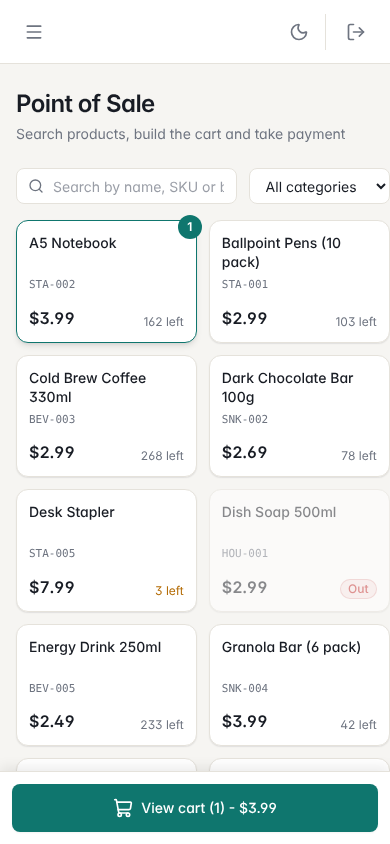 **Mobile layout** (sticky cart bar) | 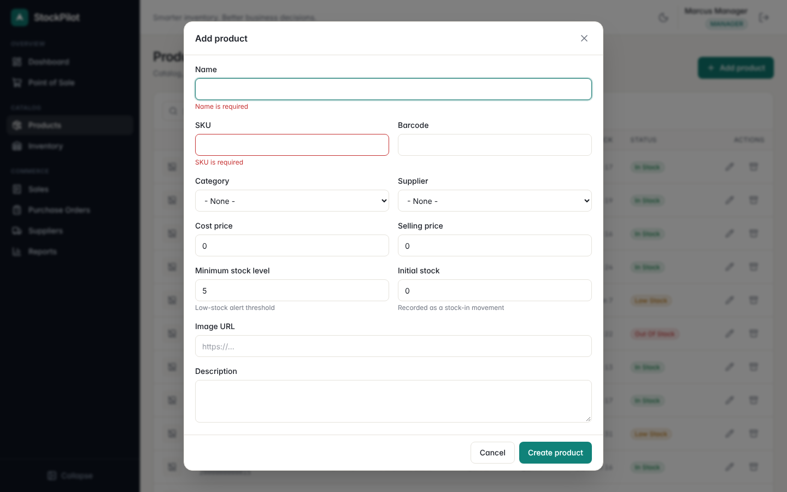 **Form validation** |

## Verification status

| Part | Status |
|---|---|
| Database migrations + demo seed | **Executed** on real PostgreSQL 16: schema and seed apply cleanly; consistency checks pass (stock equals sum of movements, sale totals equal line totals, payments equal totals); the report/aggregate SQL shapes run correctly |
| Frontend: build, types, unit/component tests | **Executed**: strict TypeScript check passes, production build succeeds (code-split), 23 Vitest tests pass |
| Frontend in a real browser | **Executed** (headless Chromium, 3 roles, desktop + mobile): every page renders with no console errors or uncaught exceptions; login failure, role-based menus and route guards, POS cart + discount limit + receipt, form validation, theme switch and sign-out all work. Run against a **stand-in API** reading the seeded database, not the Java backend |
| Sales and report money logic (`SaleCalculator`) | **Executed** (16/16 checks in a standalone harness) |
| Frontend <-> backend API contract | **Checked statically**: all 24 response types match the backend DTO fields one-to-one. Never run together |
| Backend (Spring Boot) | **Written, NOT compiled and NOT tested.** The authoring sandbox could not reach Maven Central. Sources were only syntax-checked with `javac` (no parse errors; unresolved library symbols are expected). Expect to fix a few compile or wiring errors on first `mvn clean verify` |
| Backend tests (JUnit / Mockito / Testcontainers) | **Written, NOT executed** |
| `scripts/smoke_test.py`, Postman collection, Docker / Compose / Render / GitHub Actions files | **Written, NOT executed** (syntax-checked: JSON/YAML parse, Python compiles) |

**First-run checklist for the backend:** (1) `cd backend && mvn clean verify` - fix any compile errors; the API test runs with `ddl-auto=validate`, so entity/schema mismatches surface immediately;
(2) `docker compose up --build`; (3) `python3 scripts/smoke_test.py` - ~45 checks against the live API covering auth, RBAC, stock, rollback, discounts, void, purchasing, validation and reports.

## Future improvements

Partial refunds and partial purchase receipts; customer accounts (the `customers` table is already in the schema) and loyalty;
email-link password reset, account lock-out/rate limiting, refresh tokens with httpOnly cookies; image upload; barcode scanner input;
multi-location stock and transfers; tax and multi-currency; scheduled low-stock e-mail alerts; server-side CSV/PDF reports;
a roles/permissions table with custom roles; full browser end-to-end tests against the real backend (the included Playwright script uses a stand-in API).
