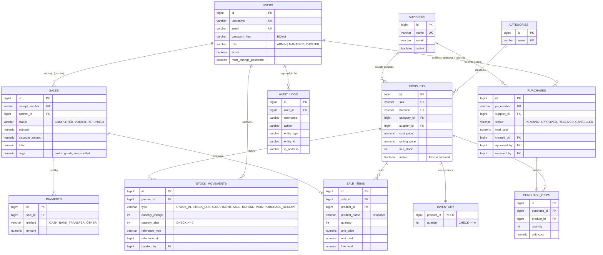

# Database ER diagram

Source of truth: [`backend/src/main/resources/db/migration/V1__core_schema.sql`](../backend/src/main/resources/db/migration/V1__core_schema.sql).
GitHub renders the Mermaid diagram below directly.

Notes
- `customers` exists in the schema (the brief lists it) but no screen or API uses it yet; see "Future improvements" in the README.
- Indexes cover the hot paths: product name/category/supplier, movements by product and date, sales by date/cashier/status, audit by date/user/action.
